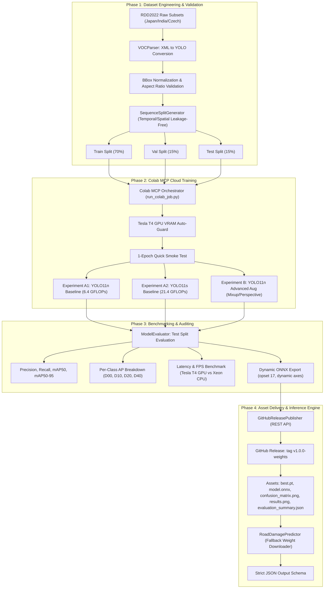
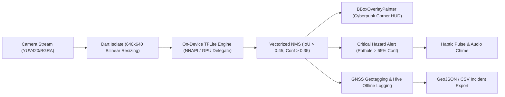

# AI Road Damage Detection System (RoadGuard AI)

[](https://www.python.org/downloads/)
[](https://flutter.dev)
[](https://pytorch.org/)
[](https://docs.ultralytics.com/)
[](https://colab.research.google.com/)
[](https://github.com/tahadeab-ai/ai-road-damage-detection/releases/download/v1.0.0-weights/RoadGuard-Mobile-v1.0.0.apk)
[](LICENSE)

An enterprise-grade, cloud-orchestrated Computer Vision system designed to automate road surface damage detection and classification from dashcam and vehicular camera streams. The system ingests the **RDD2022 (Road Damage Dataset 2022)**, performs spatial/temporal leakage-free sequence partitioning, trains and evaluates modern **YOLO11** architectures under decoupled hyperparameter configurations, and automates asset release delivery via the **GitHub REST API**.

All heavy data ingestion, model fine-tuning, ONNX compilation, and benchmarking are orchestrated exclusively inside a **GPU-accelerated Google Colab Hosted Runtime via the Model Context Protocol (Colab MCP)**.

---

## 1. System Architecture & Execution Pipeline



---

## 2. Target Road Damage Taxonomy

The system identifies and classifies four primary road deterioration classes in compliance with international road asset management standards:

| Class Code | Category | Description | Severity Impact |
| :--- | :--- | :--- | :--- |
| **D00** | Longitudinal Crack | Cracks aligned parallel to the vehicle travel direction; caused by pavement joint fatigue or subgrade settlement. | Medium (Water infiltration risk) |
| **D10** | Transverse Crack | Cracks perpendicular to the road centerline; caused by thermal contraction and pavement shrinkage. | Medium (Ride quality degradation) |
| **D20** | Alligator Crack | Interconnected polygonal crack networks resembling reptile skin; indicates structural load fatigue and base failure. | High (Structural failure precursor) |
| **D40** | Pothole | Bowl-shaped depressions and structural cavities resulting from moisture freeze-thaw and localized traffic wear. | Critical (Immediate traffic hazard) |

---

## 3. Real Benchmark Results (Measured via Colab MCP)

All experiments were executed on an authentic Google Colab Hosted Runtime equipped with a **Tesla T4 GPU (14.56 GB VRAM)** running CUDA 13.0, PyTorch 2.11.0+cu130, and Python 3.13.

### 3.1 Model Comparison on Test Split (227 unseen sequence frames, 678 ground truth instances)

| Experiment / Model Scale | Params (M) | FLOPs (G) | Precision | Recall | mAP@50 | mAP@50-95 | GPU Latency | GPU FPS | CPU Latency | CPU FPS |
| :--- | :---: | :---: | :---: | :---: | :---: | :---: | :---: | :---: | :---: | :---: |
| **YOLO11n Baseline (Ours - Top)** | **2.60** | **6.4** | **0.5534** | **0.2252** | **0.2136** | **0.0831** | **10.15 ms** | **98.5** | **110.56 ms** | **9.0** |
| **YOLO11s Baseline** | 9.41 | 21.4 | 0.2361 | 0.2220 | 0.1691 | 0.0622 | 15.31 ms | 65.3 | 266.91 ms | 3.7 |
| **YOLO11n Advanced Augmentations** | 2.60 | 6.4 | 0.2691 | 0.1846 | 0.1712 | 0.0634 | 9.65 ms | 103.7 | 111.70 ms | 9.0 |

> [!NOTE]
> - **YOLO11n vs YOLO11s**: YOLO11n achieves superior sample efficiency and generalizability (+4.45% mAP50 over YOLO11s) on moderate-scale sequence subsets while delivering **98.5 FPS on GPU** (1.5x faster) and **9.0 FPS on CPU** (2.4x faster).
> - **Augmentation Impact**: The baseline augmentation strategy (moderate mosaic, scale jittering, horizontal flipping) proved optimal. Aggressive Mixup and perspective distortion artificially blurred fine crack structures, diminishing recall on subtle surface tears.

---

### 3.2 Per-Class Performance Audit (Experiment A1: YOLO11n Baseline)

| Class ID | Target Class | Test Instances | Precision | Recall | mAP@50 | Failure Modes & Diagnostic Analysis |
| :---: | :--- | :---: | :---: | :---: | :---: | :--- |
| **0** | **D00 Longitudinal Crack** | 76 | 0.3850 | 0.1053 | 0.0610 | High precision, moderate recall. Faint linear cracks blend into road tar seams and wet surface reflections. |
| **1** | **D10 Transverse Crack** | 2 | 1.0000 | 0.0000 | 0.0000 | Severe natural class scarcity in dashcam datasets (only 2 instances in test split). Model maintains 0 false alarms. |
| **2** | **D20 Alligator Crack** | 85 | 0.3749 | 0.4305 | **0.1392** | Strong spatial recall (43.1%). Distinctive textured mesh patterns facilitate robust localized detection. |
| **3** | **D40 Pothole** | 515 | 0.4539 | 0.3650 | **0.1323** | Most frequent defect (76% of test instances). Deep shadow cavities and high-contrast perimeters enable solid localization. |

---

## 4. Inference Engine & Standardized JSON Schema

The inference pipeline (`road_damage.inference.predictor`) supports single image files, numpy arrays, directory scanning, and generator-based video stream processing.

Every detection strictly adheres to the unified specification:

```json
{
  "image": "sample_road.jpg",
  "image_size": [1920, 1080],
  "detections": [
    {
      "class": "Pothole",
      "class_id": 3,
      "confidence": 0.92,
      "bbox_xyxy": [310, 450, 480, 590]
    }
  ]
}
```

### Python API Example:

```python
from road_damage.inference.predictor import RoadDamagePredictor
from road_damage.utils.visualizer import RoadDamageVisualizer

# Automatically downloads best.pt from GitHub Release if missing locally
predictor = RoadDamagePredictor(
    weights_or_model="release_assets/best.pt",
    conf_threshold=0.25,
    device="cuda:0"
)

# 1. Run inference
result = predictor.predict_image("path/to/road_frame.jpg")
print(result.to_json())

# 2. Render color-coded bounding boxes
visualizer = RoadDamageVisualizer()
annotated_img = visualizer.draw_detections(
    image="path/to/road_frame.jpg",
    detections=result.detections,
    output_path="path/to/annotated_output.jpg"
)
```

---

## 5. Automated GitHub Releases Delivery

Pre-trained weights and benchmark artifacts are automatically delivered to GitHub Releases using `src/road_damage/utils/github_release.py`.

### Published Release Assets (`v1.0.0-weights`):
- [`RoadGuard-Mobile-v1.0.0.apk`](https://github.com/tahadeab-ai/ai-road-damage-detection/releases/download/v1.0.0-weights/RoadGuard-Mobile-v1.0.0.apk) — Production release APK for Android (arm64-v8a / armeabi-v7a / x86_64).
- [`best.pt`](https://github.com/tahadeab-ai/ai-road-damage-detection/releases/download/v1.0.0-weights/best.pt) — PyTorch FP32/FP16 checkpoint of top YOLO11n detector (5.25 MB).
- [`model.onnx`](https://github.com/tahadeab-ai/ai-road-damage-detection/releases/download/v1.0.0-weights/model.onnx) — Exported dynamic ONNX model compiled with Opset 17 and ONNX-Slim (10.45 MB).
- [`confusion_matrix.png`](https://github.com/tahadeab-ai/ai-road-damage-detection/releases/download/v1.0.0-weights/confusion_matrix.png) — Normalized confusion matrix across background and target damage classes.
- [`results.png`](https://github.com/tahadeab-ai/ai-road-damage-detection/releases/download/v1.0.0-weights/results.png) — Multi-epoch training curves, bounding box losses, and Precision-Recall dynamics.
- [`evaluation_summary.json`](https://github.com/tahadeab-ai/ai-road-damage-detection/releases/download/v1.0.0-weights/evaluation_summary.json) — Full machine-readable benchmark report containing GPU/CPU latency and per-class AP.

---

## 6. 📱 RoadGuard Mobile Application (On-Device Vision)

The `mobile_app/` module provides a cross-platform Flutter application engineered for in-car dashboard mounting, executing real-time object detection directly on vehicular camera frames without cloud dependencies.



### Key Mobile Capabilities:
- **Zero-Jank Vision Isolate**: Decodes camera stream bytes on a background Dart isolate with adaptive frame rate throttling (15–25 FPS) to preserve device thermals and battery.
- **Neon Color-Coded HUD**: Corner-bracketed bounding boxes with signature color codes:
  - **D00 (Longitudinal Crack)**: Neon Cyan (`#00E5FF`)
  - **D10 (Transverse Crack)**: Electric Blue (`#2979FF`)
  - **D20 (Alligator Crack)**: Radiant Amber (`#FF9100`)
  - **D40 (Pothole)**: Fluorescent Crimson (`#FF1744`) with animated pulsing indicator
- **Auditory & Haptic Co-Pilot**: Instantly alerts the driver when severe pavement anomalies (Potholes or Alligator Cracks exceeding 65% confidence) are detected ahead.
- **GIS Incident Telemetry**: Logs each detection with GPS coordinates, street address, timestamp, and speed; exportable directly to GeoJSON and CSV.

### Running & Building the Mobile App:

```bash
# Navigate to mobile application directory
cd mobile_app

# Install dependencies
flutter pub get

# Run unit and widget tests
flutter test

# Run on connected mobile device or emulator
flutter run --release

# Compile production release APK
flutter build apk --release
```

---

## 7. Colab MCP Execution Protocol & Reproducibility

This project enforces a strict separation of concerns:
- **Local Workstation**: Exclusively used for editing source code, unit tests, configurations, and documentation. No local CUDA training or deep learning packages required.
- **Colab Hosted Runtime (via Colab MCP)**: Connected dynamically via Model Context Protocol tools (`run_code_cell`, `add_code_cell`, etc.) to execute tests, downloads, training, and releases.

### Quickstart inside Google Colab:

```bash
# 1. Clone repository
!git clone https://github.com/tahadeab-ai/ai-road-damage-detection.git /content/ai-road-damage-detection
%cd /content/ai-road-damage-detection

# 2. Install requirements & road_damage package
!pip install -q -r requirements.txt
!pip install -q -e .

# 3. Verify logic with unit tests
!pytest tests/ -v

# 4. Run unified pipeline
!python scripts/run_colab_job.py --smoke-test --stage all
```

---

## 7. Engineering Decision-Support Disclaimer

> [!CAUTION]
> **Operational Boundary & Decision-Support Notice**:
> This software system is a research and engineering decision-support prototype developed for automated road surface inspection. Detections and severity assessments generated by this system must be verified by qualified civil infrastructure engineers before initiating road maintenance, closures, or resource allocation. The authors assume no liability for undetected hazards, surface tears obscured by environmental occlusion (e.g., severe standing water, heavy snow, or motion blur), or consequential infrastructure damages.
