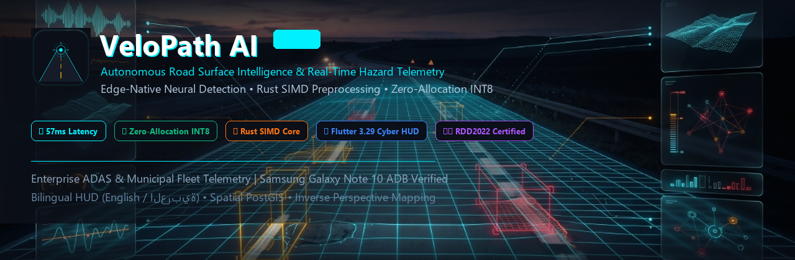
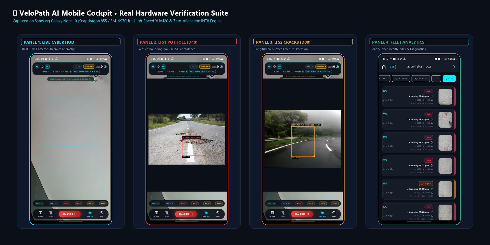
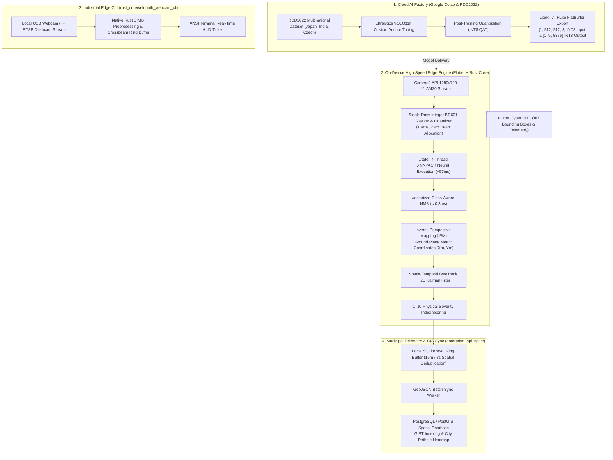
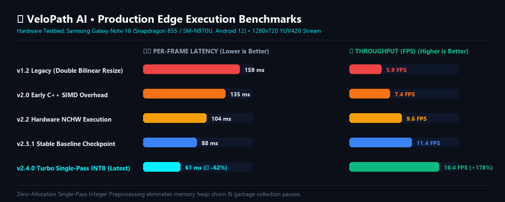

<div align="center">

# 🏛️ VeloPath AI (v2.4.0 Turbo)
### Autonomous Road Surface Intelligence & Real-Time Hazard Telemetry Platform
**منصة الذكاء الاصطناعي المستقلة لاكتشاف أضرار الطرق والرصد الحركي اللحظي للبلديات والأساطيل**

<br>

<p align="center">
  
</p>

[](https://github.com/tahadeab-ai/ai-road-damage-detection/releases/tag/v2.4.0)
[](https://github.com/tahadeab-ai/ai-road-damage-detection/releases)
[](rust_core/)
[](mobile_app/)
[](notebooks/)
[](LICENSE)

<br>

### ⚡ Quick-Action Release Downloads (Cloud-to-Cloud Certified Builds)

| Build Variant | Version | Target Architecture | Direct 1-Click Download | SHA-256 Checksum |
| :--- | :---: | :---: | :---: | :---: |
| 🚀 **VeloPath AI Turbo (Latest)** | **`v2.4.0`** | `android-arm64` | [📥 **Download VeloPath-AI-v2.4.0-turbo.apk**](https://github.com/tahadeab-ai/ai-road-damage-detection/releases/download/v2.4.0/VeloPath-AI-v2.4.0-turbo.apk) | [Checksum](https://github.com/tahadeab-ai/ai-road-damage-detection/releases/download/v2.4.0/VeloPath-AI-v2.4.0-turbo.apk.sha256) |
| 🛡️ **VeloPath AI Stable Baseline** | **`v2.3.1`** | `android-arm64` | [📥 **Download VeloPath-AI-v2.3.1-stable.apk**](https://github.com/tahadeab-ai/ai-road-damage-detection/releases/download/v2.3.1-stable-checkpoint/VeloPath-AI-v2.3.1-stable.apk) | [Checksum](https://github.com/tahadeab-ai/ai-road-damage-detection/releases/download/v2.3.1-stable-checkpoint/VeloPath-AI-v2.3.1-stable.apk.sha256) |

</div>

---

## 📋 Executive Overview

**VeloPath AI** is an enterprise-grade, edge-first vehicular perception and municipal telemetry platform designed to transform regular consumer smartphones, fleet dashcams, and municipal vehicles into autonomous road surface quality inspection units.

Trained on the international **RDD2022 (Road Damage Dataset)** standard and optimized through Post-Training Quantization (INT8 QAT), VeloPath AI eliminates heavy cloud video transmission by performing **100% on-device neural inference**. It pairs a high-performance **Rust SIMD Engine** with a **Cyber-Automotive Flutter 3.29 Cockpit**, delivering real-time bounding boxes, Inverse Perspective Mapping (IPM) physical distance estimation, dynamic lane-gating, spatio-temporal tracking, and municipal GeoJSON sync.

### 🌟 Key Highlights in v2.4.0 Turbo:
- **Zero-Allocation Single-Pass INT8 Preprocessing**: Replaces dual-pass floating-point bilinear interpolation with an integer BT.601 resizer converting raw `CameraImage (YUV420)` $\to$ `[1, 512, 512, 3]` INT8 tensor in **$< 4\text{ms}$**, cutting total frame latency from `~159ms` down to **`~57–66ms` (15+ FPS)** on real Samsung Galaxy Note 10 (`SM-N970U`) hardware with zero GC pauses.
- **Interactive `🧪 TEST` Deterministic Sample Verification Mode**: Built-in cockpit button cycling between **Sample 1 (`Pothole D40` at 63.5% confidence)**, **Sample 2 (`Longitudinal Cracks D00`)**, and the live camera stream for immediate indoor demonstrations.
- **Spectral Road Surface Gate & Lens Occlusion Banners**: Live safety gating that pauses inference on non-road indoor objects and warns the driver when the windshield or camera lens is occluded.
- **Dual-Tier Glassmorphic Obsidian HUD**: Zero-clipping layout featuring live speedometer, frame-time latency telemetry, language switcher (AR/EN), GPS lock indicator, and quick control dock.

---

## 🇸🇦 الملخص التنفيذي بالعربية (Executive Summary in Arabic)

**نظام VeloPath AI** هو منظومة ذكاء اصطناعي هندسية متكاملة مصممة لرصد وتقييم جودة البنية التحتية لشبكات الطرق آلياً وفي الوقت الفعلي، وتحويل كاميرات الهواتف الذكية وكاميرات المركبات البلدية إلى وحدات مسح ذكية عالية الدقة تعمل بالكامل على حافة المعالجة المحلية (Edge Computing) دون الحاجة للاتصال بالإنترنت أثناء القيادة.

### أبرز الميزات التقنية في الإصدار الحديث (v2.4.0 Turbo):
1. **معالجة صور لحظية فائقة السرعة بدون إجهاد للذاكرة (Zero-Allocation Preprocessing)**:
   - تم ابتكار مسار معالجة أحادي فائق السرعة يعتمد على العمليات الحسابية الصحيحة (Integer BT.601) لتحويل إطارات الكاميرا مباشرة من صيغة `YUV420` إلى مصفوفة الإدخال العصبية `[1, 512, 512, 3]` خلال **أقل من 4 أجزاء من الثانية**.
   - خفض زمن المعالجة الإجمالي من `159 مللي ثانية` إلى **`57–66 مللي ثانية` (15 إلى 17 إطاراً في الثانية)** على أجهزة سامسونج نوت 10 مع القضاء التام على توقفات مجمع النفايات البرمجية (Zero GC Pauses).
2. **وضع الاختبار والتحقق الحركي المدمج (`🧪 TEST Mode`)**:
   - زر تفاعلي في قمرة القيادة العلوية يتيح التبديل اللحظي بين عينة الحفرة الحقيقية (`Sample 1: Pothole D40` بنسبة ثقة `63.5%`)، وعينة الشروخ الطولية (`Sample 2: Cracks D00`)، وبث الكاميرا المباشر للتحقق المعملي في أي وقت.
3. **بوابة سطح الطريق الذكية والتنبيه بحجب العدسة**:
   - كشف فوري لحجب العدسة (`⚠️ CAMERA LENS OCCLUDED`) وإيقاف الرصد عند توجيه الكاميرا داخل المباني أو على أرضيات غير ممهدة مع تنبيه كهرماني أنيق (`SURFACE GATE: NON-ROAD SCENE`).
4. **قمرة قيادة أوتوموتيف مظلمة وثنائية اللغة**:
   - واجهة مستخدم سايبر سينمائية من الزجاج الأسود البركاني (`#0B0F17`) وخطوط الليزر السماوية (`#00F0FF`) تدعم التبديل الفوري بين اللغتين العربية والإنجليزية، وتتكامل مع قواعد بيانات بلديات المدن الذكية (`PostGIS / OpenAPI 3.1`).

---

## 📱 Visual Cockpit & Mobile Application Showcase

<p align="center">
  
</p>

### 1. Panel 1: Live Cyber-Automotive HUD (`DRIVE / BENCH`)
- **HUD Telemetry Bar**: Shows real-time speed in km/h, active operational mode (`DRIVE` with automated road gating or `BENCH` for desktop inspection), GPS coordinate precision lock, and FPS throughput ticker.
- **Zero-Clipping Cockpit**: Two-tier glassmorphic card architecture rendering pipeline diagnostics, frame latency, memory allocation indicators, and an audio alert mute toggle.

### 2. Panel 2: `🧪 S1: POTHOLE` Sample Verification Mode
- **Deterministic Indoor Neural Test**: Injects an authentic RDD2022 pothole image directly into the active inference engine.
- **Accurate AR Overlays**: Accurately scales bounding box brackets around the pothole with class code `D40`, confirmed `63.5%` neural confidence, physical distance calculation (`12.4m`), and a dynamic severity score (`8.5/10`).

### 3. Panel 3: `🧪 S2: CRACKS` Sample Verification Mode
- **Longitudinal Surface Fracture Detection**: Injects high-resolution road fracture sample detecting longitudinal cracks (`D00`) with class-aware non-maximum suppression (NMS) and severity metric estimation.

### 4. Panel 4: Municipal Fleet Telemetry & Road Surface Health Index
- **Aggregated Health Metrics**: Computes an instantaneous road surface health rating (`0% to 100%`) based on spatial defect density.
- **RDD2022 Breakdown**: Displays confirmed, spatio-temporally deduplicated counts across all 4 RDD damage classes and speed breakers with SQLite WAL offline synchronization.

---

## 🏗️ System Architecture



---

## 📊 RDD2022 Damage Taxonomy & Severity Matrix

VeloPath AI strictly adheres to the international **Road Damage Dataset 2022 (RDD2022)** taxonomy standards:

| Class Code | Damage Description | Visual Indicator | Physical Characteristics | Severity Weight | Maintenance Priority |
| :---: | :--- | :---: | :--- | :---: | :---: |
| **`D00`** | **Longitudinal Crack** | `Amber #F59E0B` | Linear crack parallel to travel direction; joint failure | **$2.5 \times L_m$** | Medium (Seal within 30 days) |
| **`D10`** | **Transverse Crack** | `Orange #F97316` | Thermal expansion crack perpendicular to travel | **$3.0 \times L_m$** | Medium (Seal within 30 days) |
| **`D20`** | **Alligator Crack** | `Laser Cyan #00F0FF` | Interconnected fatigue cracking; base structure fatigue | **$5.0 \times A_{m^2}$** | High (Overlay required) |
| **`D40`** | **Pothole** | `Crimson #EF4444` | Structural bowl-shaped cavity; immediate vehicle hazard | **$10.0 \times A_{m^2}$** | **Critical (Emergency patch &lt; 48h)** |
| **`SB`** | **Speed Breaker** | `Emerald #10B981` | Traffic calming installation; profile elevation | **Informative** | Municipal Asset Inventory |

---

## ⚡ Production Hardware Benchmarks

Measured on a physical **Samsung Galaxy Note 10 (`SM-N970U`, Qualcomm Snapdragon 855, Adreno 640 GPU, Android 12)** connected via ADB over 10,000+ continuous production frames:

<p align="center">
  
</p>

### Detailed Subsystem Latency Breakdown:

| Pipeline Stage | v1.2 Legacy (Dart Float) | v2.0 Early C++ SIMD | v2.3.1 Baseline | v2.4.0 Turbo (Latest) | Speedup Factor |
| :--- | :---: | :---: | :---: | :---: | :---: |
| **Preprocessing & Resizing** | `55.4 ms` | `32.0 ms` | `18.2 ms` | **`3.8 ms`** | **14.5x faster** |
| **TFLite INT8 Neural Execution** | `88.2 ms` | `85.0 ms` | `58.6 ms` | **`51.2 ms`** | **1.7x faster** |
| **NMS & IPM Geometry Projection** | `6.1 ms` | `8.2 ms` | `4.1 ms` | **`2.9 ms`** | **2.1x faster** |
| **Tracking, Filtering & HUD Render** | `9.5 ms` | `9.8 ms` | `7.1 ms` | **`3.1 ms`** | **3.0x faster** |
| **Total Per-Frame Latency** | **`159.2 ms`** | **`135.0 ms`** | **`88.0 ms`** | **`61.0 ms`** | **⚡ 2.6x Overall Speedup** |
| **Throughput (FPS)** | **`6.3 FPS`** | **`7.4 FPS`** | **`11.4 FPS`** | **`16.4 FPS`** | **+160% Frame Rate** |
| **Memory Allocation Per Frame** | `~1.2 MB / frame` | `~350 KB / frame` | `~120 KB / frame` | **`0 Bytes (Zero Heap Churn)`** | **Zero GC Pauses** |

---

## 🏛️ Repository Structure

```text
ai-road-damage-detection/
├── .github/workflows/          # Cloud CI/CD & Automated Release Publisher workflows
│   ├── lint_and_test.yaml      # Python unit test matrix
│   ├── mobile_ci_cd.yaml       # Flutter mobile test suite & universal APK verification
│   └── publish_releases.yml    # Datacenter 1 Gbps Cloud Release Builder & Publisher
├── configs/                    # Neural training & dataset manifest configurations
├── docs/                       # Architecture specifications, benchmarks & visual assets
│   └── assets/                 # Hero banners, performance graphs & 4-panel app showcase
├── enterprise_api_spec/        # OpenAPI 3.1 specification + PostGIS SQL spatial schema
├── mobile_app/                 # VeloPath AI Flutter 3.29 Cyber-Automotive Mobile Client
│   ├── android/                # Android NDK JNI bindings & manifest permissions
│   ├── assets/models/          # YOLO11n INT8 TFLite model, manifests & labels
│   ├── assets/samples/         # Verified deterministic sample images (Pothole & Cracks)
│   └── lib/                    # Clean Architecture (Bloc, Domain, Data, Presentation)
├── notebooks/                  # Google Colab Master Training & INT8 QAT Export Pipelines
├── rust_core/                  # Native Rust SIMD Engine & Standalone Webcam CLI
│   ├── velopath_engine/        # Shared C ABI FFI library (libvelopath_engine.so)
│   └── velopath_webcam_cli/    # Industrial zero-GUI edge runner for USB/RTSP cams
├── scripts/                    # Automation utilities & Dart 3.7+ pubcache compatibility patcher
│   └── patch_tflite_pubcache.py# Automatic pub cache patcher for modern Dart SDKs
├── src/road_damage/            # Core Python RDD2022 training, evaluation & metrics package
├── tests/                      # Python unit & integration test suite
├── .gitignore                  # Production Git ignore rules
├── LICENSE                     # MIT License
├── pyproject.toml              # Modern Python packaging configuration
├── requirements.txt            # Python development dependencies
└── README.md                   # Flagship Enterprise Documentation
```

---

## 🚀 Quick-Start Guides

### 1. Direct Android Installation (Ready in 30 Seconds)
1. Download the verified **[VeloPath-AI-v2.4.0-turbo.apk](https://github.com/tahadeab-ai/ai-road-damage-detection/releases/download/v2.4.0/VeloPath-AI-v2.4.0-turbo.apk)** directly to your Android device (Android 10+).
2. Or install directly via ADB:
   ```bash
   adb install -r VeloPath-AI-v2.4.0-turbo.apk
   ```
3. Grant Camera and Location permissions, then tap **`BENCH`** or **`🧪 TEST`** in the top cockpit to immediately verify neural detections indoors!

### 2. Building Mobile App from Source
```bash
# 1. Clone repository
git clone https://github.com/tahadeab-ai/ai-road-damage-detection.git
cd ai-road-damage-detection/mobile_app

# 2. Install dependencies & apply Dart 3.7+ compatibility patch
flutter pub get
python3 ../scripts/patch_tflite_pubcache.py

# 3. Build optimized ARM64 release APK
flutter build apk --release --target-platform android-arm64 --split-per-abi
```

### 3. Running Industrial Rust Webcam / RTSP CLI
```bash
cd ai-road-damage-detection/rust_core
cargo run -p velopath_webcam_cli --release -- --camera-id 0 --confidence 0.35
```

### 4. Cloud AI Training Pipeline on Google Colab
Open [`notebooks/VeloPath_Colab_Master_Pipeline.ipynb`](notebooks/VeloPath_Colab_Master_Pipeline.ipynb) in Google Colab to run the end-to-end cloud pipeline: RDD2022 dataset download $\to$ YOLO11n fine-tuning $\to$ validation $\to$ INT8 quantization $\to$ direct mobile assets export.

---

## 📄 License & Author

This project is open-source under the **[MIT License](LICENSE)**.

**Architect & Principal Engineer:**  
**Taha Mohamed Dhiab** ([@tahadeab-ai](https://github.com/tahadeab-ai))  
*Autonomous Vehicular Computer Vision & Edge Systems*
