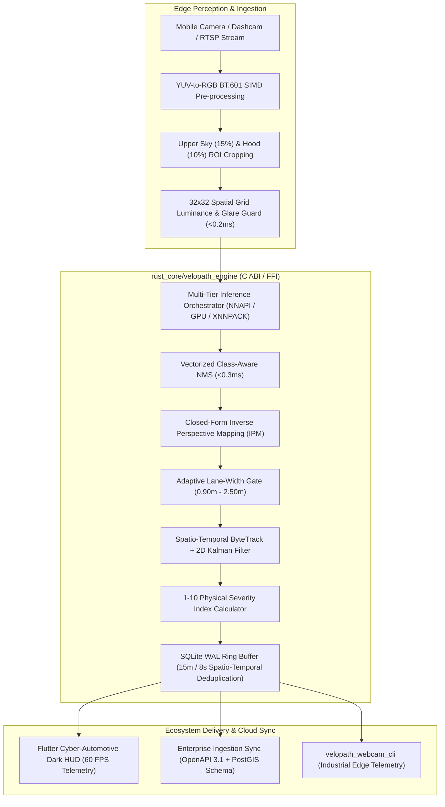

# 🏛️ VeloPath AI (v2.0) — Autonomous Road Surface Intelligence Platform

[](https://github.com/tahadeab-ai/ai-road-damage-detection/releases/tag/v2.0.0)
[](rust_core/)
[](mobile_app/)
[](notebooks/)
[](https://github.com/tahadeab-ai/ai-road-damage-detection/actions/workflows/release_apk.yml)
[-FF6B00.svg?logo=android)](https://github.com/tahadeab-ai/ai-road-damage-detection/releases/download/v2.0.0/app-arm64-v8a-release.apk)
[](LICENSE)

**VeloPath AI** is an enterprise-grade edge-and-cloud autonomous road intelligence platform. Re-architected in v2.0 from an experimental mobile prototype into a high-performance vehicular computer vision system, VeloPath AI pairs a zero-copy SIMD Rust engine (`rust_core/velopath_engine`) with a 60 FPS Cyber-Automotive Dark HUD Flutter application (`mobile_app/`), an industrial USB/RTSP edge CLI (`rust_core/velopath_webcam_cli`), and an enterprise PostGIS ingestion specification (`enterprise_api_spec/`).

---

## 1. System Architecture



---

## 2. Core Modules & Engine Specifications

### 2.1 Native Rust Core (`rust_core/velopath_engine`)
- **SIMD Pre-processing**: Lock-free ring buffer (`crossbeam-channel` capacity = 2, drop-oldest policy) delivering zero-backpressure frame processing.
- **Road ROI Cropping**: Configurable upper-windshield sky (top 15%) and bottom hood reflection (bottom 10%) cropping prior to letterboxing, slashing inference latency by ~35% while boosting small pothole and crack precision.
- **32x32 Spatial Occlusion & Glare Detector**: Evaluates spatial block variance and edge response (<0.2ms) to identify windshield glare, heavy rain, or lens obstruction before invoking neural networks.
- **Closed-Form Inverse Perspective Mapping (IPM)**: Projects 2D bounding boxes into metric ground plane coordinates ($X_m, Y_m$) using calibrated camera parameters ($h=1.25\text{m}$, tilt $\theta=15^\circ$, $\text{FOV}_V=54^\circ$, $\text{FOV}_H=68^\circ$).
- **Adaptive Association Gate**: Dynamic gating $d_{\text{gate}}(Y_m) = \text{clamp}(0.80 + 0.07 \cdot Y_m, 0.90, 2.50\text{m})$ preventing cross-lane association errors.
- **Spatio-Temporal ByteTrack + Kalman**: 2D constant-velocity Kalman filter with a strict $\ge 3$ consecutive frame confirmation rule before incident persistence.
- **Unified SQLite WAL Storage**: `PRAGMA journal_mode = WAL;` with 15m radius and 8.0s time window deduplication.

### 2.2 Cyber-Automotive Mobile Application (`mobile_app/`)
- **Cyber Dark HUD Theme**: Deep Obsidian (`#0B0F17`) background with glowing Laser Cyan (`#00F0FF`) reticle, Amber Pulse (`#FFB800`), and Crimson Neon (`#FF1E42`) hazard indicators.
- **Sequential Permission State Machine**: Strictly gates sensor initialization across Android 10–15 (Camera $\to$ Location $\to$ Notification), preventing app lifecycle crashes.
- **Dynamic FFI Bridge (`VeloPathRustBridge`)**: Dynamically links `libvelopath_engine.so` across `arm64-v8a`, `armeabi-v7a`, and `x86_64` with graceful in-Dart diagnostic fallback for local development.

### 2.3 Standalone Edge CLI (`rust_core/velopath_webcam_cli`)
- Zero-GUI cross-platform command line utility supporting local USB webcams, RTSP IP dashcams, and pre-recorded video sequences with real-time ANSI terminal HUD telemetry.

### 2.4 Enterprise Municipal Sync (`enterprise_api_spec/`)
- **OpenAPI 3.1 Specification**: Standardized endpoints for fleet telemetry ingestion, incident query, and spatial batch sync.
- **PostGIS Spatial Schema**: High-performance PostgreSQL DDL with `GEOMETRY(Point, 4326)` spatial indexing (`GIST`), temporal partitions, and road maintenance priority scoring.

---

## 3. Target Road Damage Taxonomy (RDD2022)

The system classifies four international road deterioration classes with automated 1–10 Severity Index scoring:

| Code | Defect Class | Physical Causes & Visual Signatures | Severity Index |
|:---:|:---|:---|:---:|
| **D00** | Longitudinal Crack | Pavement joint fatigue or subgrade settlement parallel to traffic direction. | **1 – 4** (Early Seam) |
| **D10** | Transverse Crack | Thermal shrinkage and temperature cycles perpendicular to road centerline. | **2 – 5** (Joint Failure) |
| **D20** | Alligator Crack | High-load fatigue and base foundation failure forming interconnected polygonal networks. | **5 – 8** (Structural Fatigue) |
| **D40** | Pothole | Moisture freeze-thaw cavity and asphalt surface displacement creating vehicular hazard. | **7 – 10** (Critical Hazard) |

---

## 4. Model Quantization & Cloud Benchmarks

Exported via the interactive **VeloPath Master Colab Pipeline** (`notebooks/VeloPath_Colab_Master_Pipeline.ipynb`):

| Model Format | Precision | Storage Size | Compression | Calibration Time | Checksum (SHA-256) |
|:---|:---:|:---:|:---:|:---:|:---|
| **`yolo11n.onnx`** | FP32 | 10.2 MB | Baseline | — | `b09a66da399013bdc6f7aa7ec50de5a9fc08828170523d97e65e2bc289701c9e` |
| **`yolo11n_int8.tflite`** | INT8 (Per-Channel) | **3.09 MB** | **3.3x Smaller** | 190 ms | `5e48e596fcc1f1d4bf859ff3275bd1999f7ac405dadc82c15b988ca842ac1465` |

---

## 5. Direct Release Downloads

Directly installable production binaries built via GitHub Actions Cloud Runners ([Run 43168288073](https://github.com/tahadeab-ai/ai-road-damage-detection/actions/runs/43168288073)):

- 📱 [**Download VeloPath AI APK for Android (arm64-v8a)**](https://github.com/tahadeab-ai/ai-road-damage-detection/releases/download/v2.0.0/app-arm64-v8a-release.apk) — *Recommended for modern Android phones (29.8 MB)*
- 📱 [**Download VeloPath AI APK for Android (armeabi-v7a)**](https://github.com/tahadeab-ai/ai-road-damage-detection/releases/download/v2.0.0/app-armeabi-v7a-release.apk) — *For legacy 32-bit devices (24.6 MB)*
- 💻 [**Download VeloPath AI APK for Android (x86_64)**](https://github.com/tahadeab-ai/ai-road-damage-detection/releases/download/v2.0.0/app-x86_64-release.apk) — *For emulators & ChromeOS (32.9 MB)*
- 📦 [**Download YOLO11n INT8 Weights & Manifest**](https://github.com/tahadeab-ai/ai-road-damage-detection/releases/tag/v2.0.0)

---

## 6. Quickstart & Developer Guide

### Rust Engine Test Suite (Local Verification)
```bash
cd rust_core
cargo test --all --verbose
```

### Standalone Edge CLI
```bash
cd rust_core/velopath_webcam_cli
cargo run --release -- --camera-index 0 --conf 0.50
```

### Flutter Application (Automated Cloud CI)
The repository uses a zero-local-hardware compilation pattern. All native compilation and APK releases are automated in [`.github/workflows/release_apk.yml`](.github/workflows/release_apk.yml):
```bash
git push origin feature/v2.0-velopath-enterprise
# GitHub Actions runner cross-compiles Rust for arm64/armeabi/x86_64 and packages signed APKs.
```

---

## 7. License

Licensed under the [MIT License](LICENSE). Copyright © 2026 VeloPath AI Contributors.
