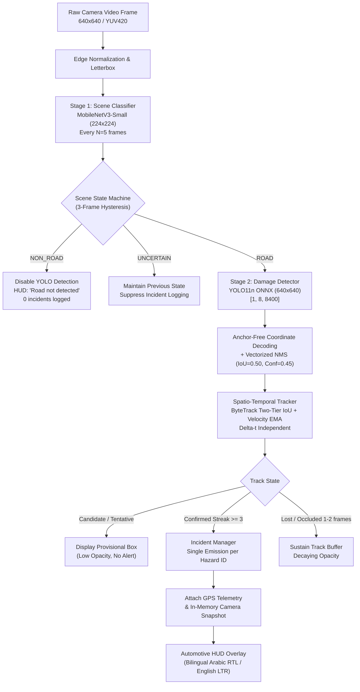

# RoadGuard AI V1.1 — System Architecture Document

**System Version**: V1.1  
**Architecture Theme**: Two-Stage Edge Scene Intelligence & Persistent Spatio-Temporal Hazard Tracking  
**Target Environment**: Mobile Edge (Android ARM64 / ARMv7)  

---

## 1. High-Level System Architecture

RoadGuard AI V1.1 enhances detection reliability by introducing a **hierarchical two-stage edge computer vision pipeline**. Rather than running high-compute object detection on unverified camera input, the system validates that the camera is observing a navigable roadway before activating the damage detector.

---

## 2. Pipeline Stages

### Stage 1: Lightweight MobileNetV3-Small Scene Classifier
- **Objective**: Prevent false damage alarms on indoor walls, ceilings, floors, furniture, vehicles, and building facades.
- **Backbone**: `MobileNetV3-Small` (pretrained on ImageNet-1K).
- **Parameters**: $\approx 1.52\text{M}$ parameters (extremely lightweight: $<6\text{ MB}$ FP32, $\approx 1.8\text{ MB}$ INT8).
- **Input Contract**: `[1, 3, 224, 224]` float32 tensor normalized via standard ImageNet mean `[0.485, 0.456, 0.406]` and std `[0.229, 0.224, 0.225]`.
- **Output Contract**: Binary logits / probabilities:
  - `0`: `ROAD` (asphalt, concrete, dirt, paved roads across day, night, rain, shadows).
  - `1`: `NON_ROAD` (rooms, indoor floors, tiles, walls, furniture, ceilings, sky).
- **Execution Strategy**: Runs periodically every $N=5$ frames. At $30\text{ FPS}$, this executes only $6\text{ times/sec}$, consuming $<15\text{ ms}$ on mobile CPU/NPU while conserving battery.

### Stage 2: Temporal Scene State Machine (Hysteresis)
To avoid jitter and rapid toggling between road and non-road when passing under bridges or momentary obstructions:
- **Confirmation Threshold**: Requires $3$ consecutive consistent frames to transition state (`ROAD` $\to$ `NON_ROAD` or vice-versa).
- **Confidence Gates**:
  - $P(\text{ROAD}) \ge 0.70 \implies \text{ROAD}$.
  - $P(\text{NON\_ROAD}) \ge 0.75 \implies \text{NON\_ROAD}$.
  - Between $0.30$ and $0.70 \implies \text{UNCERTAIN}$ (preserves prior validated state).

### Stage 3: YOLO11n Road Damage Detector
- **Input Contract**: `[1, 3, 640, 640]` float32 tensor normalized to $[0.0, 1.0]$.
- **Output Tensor**: `[1, 8, 8400]` float32 tensor.
- **Classes**:
  - `0`: `D00_longitudinal_crack`
  - `1`: `D10_transverse_crack`
  - `2`: `D20_alligator_crack`
  - `3`: `D40_pothole`

### Stage 4: Persistent Spatio-Temporal Hazard Tracker
- **Two-Tier Association (ByteTrack Principle)**:
  - Tier 1: Associates high-confidence detections ($c \ge 0.45$) using Hungarian IoU matching and centroid distance.
  - Tier 2: Associates remaining unconfirmed tracks against lower-confidence detections ($0.25 \le c < 0.45$) to sustain tracking through temporary motion blur or shadows.
- **Kalman / EMA Bounding Box Smoothing**:
  $$\text{Box}_{t} = \alpha \cdot \text{Box}_{\text{detected}} + (1 - \alpha) \cdot \text{Box}_{t-1}^{\text{predicted}}$$
  Smooths bounding box corners, eliminating visual jumps on camera vibration.
- **Occlusion Grace Period**: Tracks survive up to $2$ missed frames before being marked as `Lost` and pruned.
- **Single Incident Emission**: Emits an alert and logs an incident only upon transition to `Confirmed` (Streak $\ge 3$). Subsequent observations update velocity and bounding box without duplicate emissions.

---

## 3. Mobile UI/UX Integration

The HUD state machine reflects both scene intelligence and hazard tracking:

| State | HUD Badge / Status Text | Icon | Audio / Alert | Damage Detection |
| :--- | :--- | :---: | :---: | :---: |
| **Startup / Calibrating** | *"Checking scene..."* | 🔍 | Silent | Disabled |
| **Active Roadway** | *"Road detected • Scanning"* | 🛣️ | Silent | Active |
| **Off-Road / Indoor** | *"Road not detected"* | 🚫 | Silent | **Completely Suppressed** |
| **Hazard Candidate** | *"Tracking hazard..."* (Streak < 3) | ⚠️ | Silent (Provisional box) | Active |
| **Confirmed Hazard** | *"POTHOLE DETECTED (#042)"* | 🚨 | Automotive Audio Chime | Incident Logged Once |
