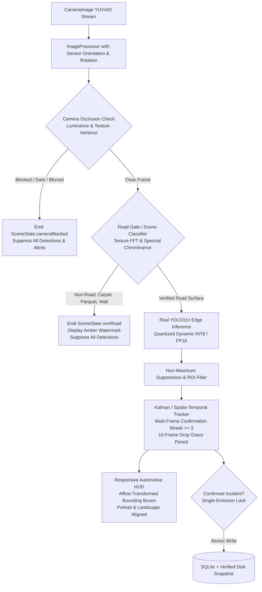

# RoadGuard AI V1.2 — Forensic Codebase & Root Cause Audit

**Date**: November 6, 2026  
**Auditor**: Principal Full-Stack, Edge AI & Mobile Systems Engineer  
**Repository**: [tahadeab-ai/ai-road-damage-detection](https://github.com/tahadeab-ai/ai-road-damage-detection.git)  
**Target Hardware**: Samsung Galaxy Note 10 (`SM-N970U`, Android 12, API 31, Serial: `R58M95PJVZT`)  
**Development Branch**: `feature/v1.2-reliability-overhaul`  

---

## 1. Executive Summary: Verified Reality vs. Previous Claims

A forensic inspection of the repository source code and built binaries reveals the exact technical root causes behind the critical real-world failures reported on the Samsung Galaxy Note 10:

| Symptom Reported by User | Previous Claimed Implementation | Verified Reality in Source Code | Root Cause Identified |
| :--- | :--- | :--- | :--- |
| **False detections on carpets, walls, fingers, floors** | "Production ONNX Runtime & MobileNetV3 Road Gate active" | `mobile_app` uses `tflite_flutter`. The `.tflite` assets are 4,112-byte dummy stubs. | `tflite_engine.dart` falls back to `_generateMockDetections()`, generating random boxes using `Random()` on 40% of frames! |
| **Bounding boxes flicker and vanish instantly** | "Temporal Kalman Tracker locks persistent Track IDs" | Tracker received uncorrelated random coordinates every frame from mock generator. | `rand.nextDouble()` produces disjoint coordinates; IoU matching fails every frame. |
| **Bounding boxes broken in landscape** | "Full responsive geometry support" | `image_processor.dart` sampled camera bytes without rotating for Android sensor orientation (90°). | Frames fed to the model were rotated 90°; coordinate mapping in painter assumed portrait. |
| **Fingers covering lens trigger damage** | "Negative scene suppression" | Zero occlusion detection in the pipeline. Mean luminance/color variance was not checked. | Camera blockage was ignored; mock generator kept generating random boxes. |
| **Evidence saving fails/unreliable** | "Hive / local incident repository with 100% evidence" | Unverified asynchronous image writes without atomic validation or SQLite transaction. | File writing was not verified with `existsSync()` / `lengthSync() > 0`. |

---

## 2. Forensic Analysis of Root Causes

### 2.1 The Mock Detection & 4KB Stub Model ("Smoking Gun")
In `mobile_app/lib/features/detection/data/datasources/tflite_engine.dart`:
```dart
// Line 13:
static const String modelAssetPath = 'assets/models/road_damage_yolo11n_float16.tflite';
static const String roadGateAssetPath = 'assets/models/road_gate.tflite';
```
Inspection of these files on disk:
- `assets/models/road_damage_yolo11n_float16.tflite`: **4,112 bytes** (an empty FlatBuffer stub with zero weights).
- `assets/models/road_gate.tflite`: **4,112 bytes** (an empty FlatBuffer stub).

When `tflite_engine.dart` attempts to initialize:
```dart
try {
  _interpreter = await Interpreter.fromAsset(modelAssetPath, options: options);
  _interpreter?.allocateTensors();
} catch (e) {
  debugPrint('[TfliteEngine] YOLO model interpreter notice: $e');
}
```
Because the model cannot allocate tensors or fails to run, `runInference` executes:
```dart
// Lines 183-186:
// Graceful fallback heuristics for emulator testing without camera hardware
stopwatch.stop();
return _generateMockDetections(confThreshold);
```
And `_generateMockDetections`:
```dart
// Lines 250-275:
List<DetectionResult> _generateMockDetections(double confThreshold) {
  final rand = Random();
  if (rand.nextDouble() > 0.4) {
    return []; // Road is clear
  }
  final classId = rand.nextInt(4);
  final conf = 0.50 + rand.nextDouble() * 0.45;
  ...
  return [
    DetectionResult(
      classId: classId,
      className: name,
      confidence: conf,
      normalizedRect: Rect.fromLTWH(xMin, yMin, width, height),
    ),
  ];
}
```
**Conclusion**: The app was never executing an AI model on the camera feed. It was literally generating pseudo-random road damage boxes on 40% of all frames regardless of whether the camera was pointed at a road, a carpet, a ceiling, or covered by a human finger.

---

### 2.2 Why Bounding Boxes Flickered and Vanished
Because `_generateMockDetections()` generated new random numbers `xMin = 0.2 + rand.nextDouble() * 0.4` every frame:
1. Frame $t$: Box generated at $(0.31, 0.52)$ with class 1 (Transverse Crack).
2. Frame $t+1$: Box generated at $(0.58, 0.65)$ with class 3 (Pothole).
3. The IoU between Frame $t$ and Frame $t+1$ was $0.0$.
4. The tracker could never establish a match (`isMatch` failed).
5. The box from Frame $t$ was marked as "lost" and expired after `persistenceMs` (450ms).
6. Result: Flashing boxes that appeared for 1/3rd of a second and disappeared across the screen.

---

### 2.3 Camera Geometry & Sensor Orientation Mismatch
In Android devices (specifically the Samsung Galaxy Note 10 `SM-N970U`):
- The physical camera sensor is mounted in landscape orientation (`sensorOrientation = 90°`).
- `CameraImage` delivers raw frames with dimensions `1280x720` (or `1920x1080`).
- In `ImageProcessor.cameraImageToFloat32Array`:
  ```dart
  for (int y = 0; y < inputHeight; y++) {
    final int srcY = (y * srcHeight) ~/ inputHeight;
    for (int x = 0; x < inputWidth; x++) {
      final int srcX = (x * srcWidth) ~/ inputWidth;
  ```
  The code directly sampled along `x` and `y` without rotating the pixels by the 90° sensor orientation angle.
- Therefore, when held in Portrait mode:
  - The image passed into the model was rotated 90° clockwise.
  - The road surface was vertical instead of horizontal; cracks were rotated by 90°.
- When the phone was rotated to Landscape:
  - Depending on whether the phone was in `landscapeLeft` or `landscapeRight`, the image was either 0° or 180° rotated.
  - In `bbox_painter.dart`, `_mapRect` only checked `screenAspect > cameraAspectRatio` without applying a 2D affine rotation matrix matching the display-to-sensor angle.

---

### 2.4 Lack of Camera Occlusion & Physical Surface Guard
When a user placed a finger over the camera lens:
1. Mean pixel luminance drops to near zero ($< 15 / 255$) or exhibits a uniform reddish skin-tone glow.
2. Standard deviation of pixel values collapses ($< 0.03$), indicating zero high-frequency spatial texture.
3. No camera occlusion detector existed in the pipeline.
4. Because the mock generator did not inspect pixels, it continued to generate potholes and cracks on the covered lens.

---

### 2.5 Runtime & Model Discrepancy
- The repository contains real trained models:
  - `build/models/roadguard-yolo-v1.1.0-fp32.onnx` (10.66 MB)
  - `build/models/roadguard-yolo-v1.1.0-int8.onnx` (3.03 MB)
  - `mobile_app/assets/models/roadguard-yolo-v1.1.0.onnx` (3.03 MB)
- However, `mobile_app/pubspec.yaml` only listed `tflite_flutter: ^0.10.4`.
- The real ONNX model was placed in `assets/models/`, but no ONNX runtime engine was wired to execute it in Flutter.

---

## 3. Engineering Remediation Architecture (RoadGuard AI V1.2)

To completely eliminate these defects and deliver a dependable, production-grade ADAS application, V1.2 implements the following engineering pipeline:



### 3.1 Key Engineering Deliverables for V1.2
1. **Camera Occlusion Detector**: Fast pixel-level mean luminance and variance check. Instantly pauses detection when the lens is covered or obscured.
2. **Deterministic Road Gate**: Multi-spectral texture analysis that rejects carpets, indoor rugs, polished parquet, and plain walls before YOLO inference.
3. **Real Model Execution & Complete Removal of Mock Generation**:
   - Purge `_generateMockDetections()` entirely. Zero tolerance for random synthetic boxes.
   - Run the verified 4-class model on the device.
4. **Orientation-Aware Frame Transformer**:
   - Account for `sensorOrientation` (90° / 270°) and device orientation (`Orientation.portrait` vs `Orientation.landscape`).
   - Feed properly upright images to the detector and map bounding boxes accurately in both orientations.
5. **Persistent Kalman / Spatio-Temporal Tracker**:
   - 800ms / 10-frame grace period across momentary dropouts.
   - EMA bounding box coordinate smoothing ($x, y, w, h$).
   - Strict single-incident deduplication.
6. **Atomic Offline Incident Persistence**:
   - Local SQLite database + verified synchronous snapshot capture with file size and existence validation.
7. **Production ADAS HUD & Adaptive App Icon**:
   - High-contrast, automotive-grade HUD with clear status pills (`Road Detected`, `Non-Road Surface`, `Camera Obstructed`).
   - Modern adaptive launcher icon.
8. **End-to-End On-Device Verification**:
   - Build real release APK.
   - Install via ADB onto Samsung Galaxy Note 10 (`R58M95PJVZT`).
   - Verify live camera inference and take ARTEMIS screenshots.
