# ROADGUARD AI — Master Engineering Implementation Plan

## Goal Description
Transform RoadGuard AI from an experimental road defect detection prototype into an enterprise-grade, automotive-hardened, real-time edge AI driver assistance system (ADAS). This comprehensive engineering effort spans:
1. Complete codebase & architecture audit (`docs/PROJECT_AUDIT.md`).
2. Google Colab-driven dataset curation, augmentation, and YOLO comparative benchmarking (`notebooks/colab/` notebooks 01–09, `docs/MODEL_EVALUATION.md`).
3. Optimized mobile inference pipeline with hardware delegation (NNAPI / GPU).
4. Persistent spatial object tracking (Kalman / Centroid / IoU motion tracking with persistent Track IDs and frame-drop interpolation).
5. De-duplicated incident management (one record per unique track event with guaranteed in-memory snapshot evidence).
6. Complete Dark Automotive UI/UX redesign with custom high-contrast icon and HUD telemetry.
7. End-to-end Arabic (RTL) & English (LTR) bilingual localization.
8. Resolution of Android APK "App not installed as package appears to be invalid" via multi-ABI support (`arm64-v8a`, `armeabi-v7a`, `x86_64`), explicit v1/v2 release signing, and comprehensive ProGuard rules.
9. Full QA test suite (`docs/TESTING_REPORT.md`), CI/CD GitHub Actions workflow, and semantic GitHub Releases deployment.

---

## User Review Required

> [!IMPORTANT]
> **Android ABI & Compatibility Fix**: The current Gradle configuration explicitly restricts `abiFilters` to `arm64-v8a` only and signs release builds with the debug keystore. This is the primary root cause of Android's *"App not installed as package appears to be invalid"* error on 32-bit devices, emulators (x86_64), or Android 14+ devices requiring explicit v2/v3 signatures. We will expand `abiFilters` to `arm64-v8a`, `armeabi-v7a`, and `x86_64`, configure an explicit production signing block, and generate both universal and architecture-specific release APKs.

> [!WARNING]
> **AI Gatekeeper Architecture Discipline**: In accordance with the Critical Project Rules, we avoid adding a separate heavy classification network. The road surface gating mechanism is kept strictly ultra-lightweight and integrated directly into the spatial pipeline to preserve 60 FPS mobile rendering and eliminate unnecessary model switching overhead.

---

## Open Questions

1. **GitHub Releases Tag Strategy**: Should the final production release be tagged `v1.1.0` (maintaining `v1.0.0-weights` as baseline) or updated under a new semantic tag `v1.2.0`? (Recommended: `v1.1.0` with full asset packaging).
2. **Colab Execution Scope**: While all 9 Colab notebooks (`01_Dataset_Analysis.ipynb` through `09_Final_Model_Comparison.ipynb`) will be generated with complete, reproducible, and executable code blocks, would you prefer us to trigger training runs locally or leave large-scale GPU training execution to your Google Colab Pro session? (Recommended: Notebooks prepared for immediate Colab one-click execution).

---

## Proposed Changes

```mermaid
flowchart TD
    subgraph Mobile Edge Architecture
        Camera[Camera YUV420/BGRA Stream] --> FrameQueue[Non-blocking Frame Dropper]
        FrameQueue --> Preprocess[Letterbox & Float32 Normalization]
        Preprocess --> RoadGate[Lightweight Road Surface Filter]
        RoadGate -->|Non-Road| Skip[Skip YOLO / Suppress]
        RoadGate -->|Road Surface| Inference[YOLO11 TFLite FP16 / NNAPI]
        Inference --> NMS[IoU 0.35 Non-Max Suppression]
        NMS --> Tracker[Centroid + IoU Spatial Tracker]
        Tracker -->|Assign Track ID| TrackPool[Persistent Tracks & EMA Smoothing]
        TrackPool --> Overlay[Automotive Reticle Painter]
        TrackPool -->|Confirmed Incident| Snapshot[In-Memory JPEG Annotator]
        Snapshot --> HiveDB[Hive Offline Incidents Store]
    end
    subgraph Localization & UI
        LangNotifier[AppLanguageNotifier Singleton] --> DirectionalityRTL[Arabic RTL / Cairo Font]
        LangNotifier --> DirectionalityLTR[English LTR / Sans]
        DirectionalityRTL --> TopHUD[FittedBox Zero-Overflow HUD]
        DirectionalityLTR --> TopHUD
    end
```



---

### Component 1: Audit, Documentation & Colab Experimentation Pipeline

#### [NEW] `docs/PROJECT_AUDIT.md`
- Comprehensive architecture review, analysis of bounding box flickering root causes, Android package installation analysis, and dependency matrix.

#### [NEW] `docs/MODEL_EVALUATION.md`
- Multi-model evaluation comparing YOLO11n, YOLO11s, YOLO26n architectures on RDD2022 dataset across Precision, Recall, mAP50, mAP50-95, FPS, latency, and model size.

#### [NEW] `docs/TESTING_REPORT.md`
- Complete test report covering AI inference schema, unit tests, widget rendering tests, localization RTL/LTR verification, and Android installation verification.

#### [NEW] `notebooks/colab/`
1. `01_Dataset_Analysis.ipynb`: Class distribution, leakage checks, bounding box aspect ratios.
2. `02_Data_Cleaning_and_Validation.ipynb`: Corrupted image filtering, annotation normalization.
3. `03_Data_Augmentation.ipynb`: Negative sample injection (shadows, oil stains, manholes, reflections).
4. `04_YOLO11_Training.ipynb`: Hyperparameter optimization, loss curves, validation logging.
5. `05_YOLO26_Experiments.ipynb`: Comparative architecture evaluation.
6. `06_Model_Evaluation.ipynb`: Confusion matrix generation, PR curves, F1 analysis.
7. `07_Error_Analysis.ipynb`: Hard example mining, false positive / false negative inspection.
8. `08_Model_Export_and_Quantization.ipynb`: ONNX, TFLite FP16, and INT8 calibration.
9. `09_Final_Model_Comparison.ipynb`: Unified benchmark metrics and selection summary.

---

### Component 2: Android Build Configuration & Package Resolution

#### [MODIFY] `mobile_app/android/app/build.gradle.kts`
- Expand `ndk.abiFilters` to include `arm64-v8a`, `armeabi-v7a`, and `x86_64` to eliminate "package appears to be invalid" error on varied hardware.
- Configure dedicated release `signingConfigs` with explicit v1 and v2 signing enabled.
- Add complete ProGuard keep rules for Flutter plugins, TFLite delegates, and native bindings.

```kotlin
android {
    defaultConfig {
        applicationId = "com.roadguard.road_guard_mobile"
        minSdk = 26
        targetSdk = 34
        versionCode = 2
        versionName = "1.1.0"
        ndk {
            abiFilters.clear()
            abiFilters.addAll(listOf("arm64-v8a", "armeabi-v7a", "x86_64"))
        }
    }
    signingConfigs {
        create("release") {
            // Self-signed production release keystore fallback
            storeFile = file("release-keystore.jks")
            storePassword = "roadguardrelease"
            keyAlias = "roadguard"
            keyPassword = "roadguardrelease"
            enableV1Signing = true
            enableV2Signing = true
        }
    }
}
```

#### [MODIFY] `mobile_app/android/app/proguard-rules.pro`
- Add keep rules for TFLite, Camera, PathProvider, Geolocator, AudioPlayers, and Hive.

---

### Component 3: Persistent Object Tracking & Deduplication Pipeline

#### [MODIFY] `mobile_app/lib/core/utils/temporal_filter.dart`
- Implement Kalman/Centroid velocity tracking with integer Track IDs (e.g., `#001`).
- Downward perspective motion extrapolation: smooth downward tracking across frame drops until the hazard exits the lower screen edge.
- Track grace period (350–700ms) ensuring bounding boxes do not flash or vanish prematurely.

#### [MODIFY] `mobile_app/lib/features/detection/presentation/bloc/detection_bloc.dart`
- Non-blocking frame queue: discard incoming frames if inference is active to prevent lag.
- De-duplicated incident logging: record only **one** incident per unique Track ID.
- Guaranteed in-memory snapshot evidence: write high-quality annotated JPEGs directly to local storage without driver lockup.

---

### Component 4: Automotive UI/UX Redesign & Bilingual Engine

#### [MODIFY] `mobile_app/lib/features/detection/presentation/widgets/camera_hud_overlay.dart`
- FittedBox top telemetry bar preventing text overlap on narrow screens.
- Digital speedometer, latency/FPS tag, confirmed hazard count, and one-tap language switch (`EN` / `عربي`).

#### [MODIFY] `mobile_app/lib/features/detection/presentation/widgets/bbox_painter.dart`
- Target locking brackets, track ID badges (`#001 Pothole 94%` / `#001 حفرة 94%`), and smooth color-coded neon accents.

#### [MODIFY] `mobile_app/lib/features/history/presentation/pages/hazard_log_screen.dart`
- Fullscreen interactive zoom/pan evidence viewer, category filters, and GeoJSON/CSV exports.

---

### Component 5: CI/CD Workflows & GitHub Release Pipeline

#### [NEW] `.github/workflows/mobile_release.yaml`
- Automated Flutter analyze, unit tests, Android release build, SHA-256 checksum generation, and GitHub Release asset publishing.

#### [NEW] `docs/FINAL_DELIVERY_REPORT.md`
- Comprehensive closing report detailing initial state, modifications, benchmark metrics, test logs, and release links.

---

## Verification Plan

### Automated Tests
1. **Flutter Analysis**:
   ```powershell
   cd mobile_app
   flutter analyze
   ```
2. **Flutter Test Suite**:
   ```powershell
   flutter test
   ```
3. **Android Release Build & ABI Verification**:
   ```powershell
   flutter build apk --release
   ```
4. **Python Test Suite**:
   ```powershell
   pytest tests/
   ```

### Manual Verification
1. **Bilingual Toggle**: Tap `EN` / `عربي` in the top HUD and verify instant RTL/LTR transformation without widget clipping.
2. **APK Installation**: Verify clean installation via `adb install -r build/app/outputs/flutter-apk/app-release.apk` without "package appears to be invalid" errors.
3. **Live Camera & Tracking**: Verify live camera preview streams smoothly, defects receive stable `#ID` badges, and confirmed incidents save with visual image thumbnails in the logs screen.
